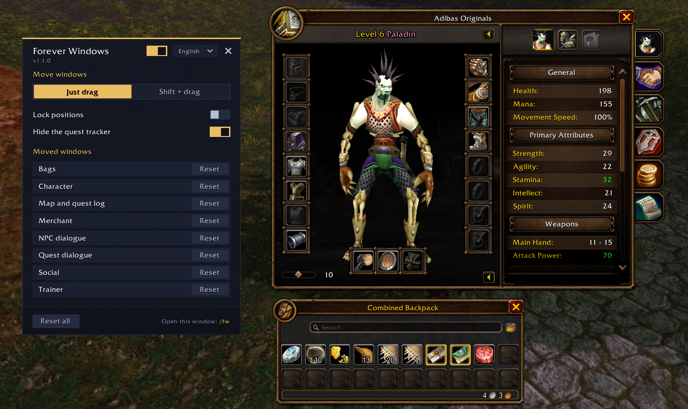

# Forever Windows

Game windows always open at the same spot, often right where you don't want them, and moving them is not possible by default.

Forever Windows lets you drag any game window where you like, and it opens there from then on, without jumping. Built for **World of Warcraft: Forever**.

- Character, bags, map, merchants, quest and NPC dialogues, trainers, mail, bank, professions and more
- Just drag, or Shift + drag so nothing moves by accident
- Lock positions when you're done
- A list of moved windows, each with its own reset
- Optional: hide the quest tracker
- Protected windows move into place right after combat
- English and Russian
- Settings: `/fw`

**Install:** unzip the `ForeverWindows` folder into `World of Warcraft/_forever_/Interface/AddOns/` and restart the game.

MIT license.

---

**RU:** перетащи любое окно игры куда удобно, и дальше оно открывается там, без прыжков. Настройки: `/fw`.
